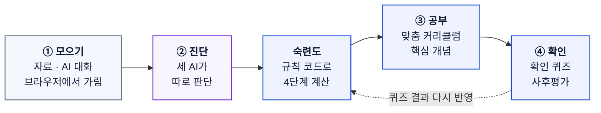
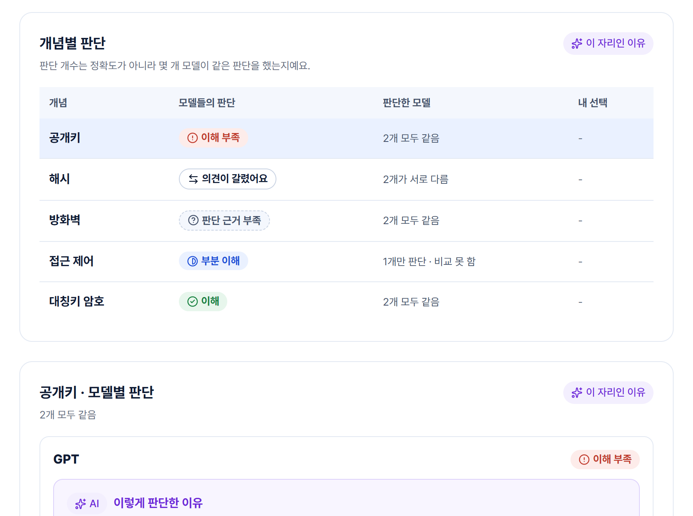
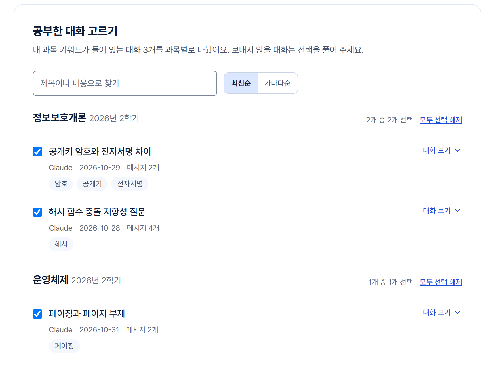
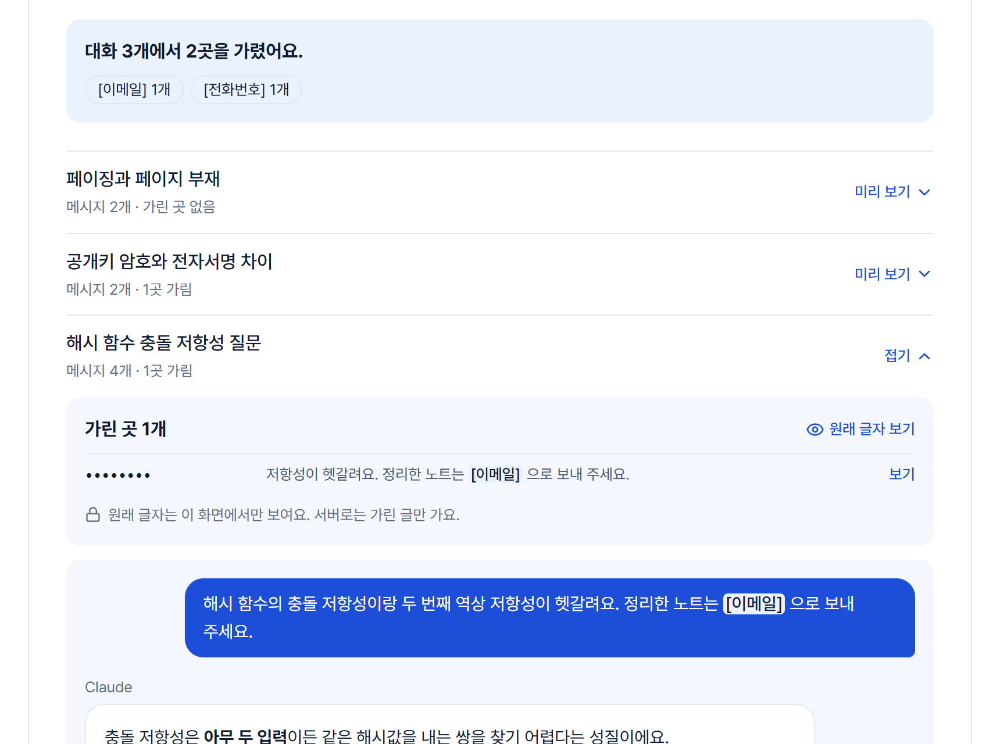
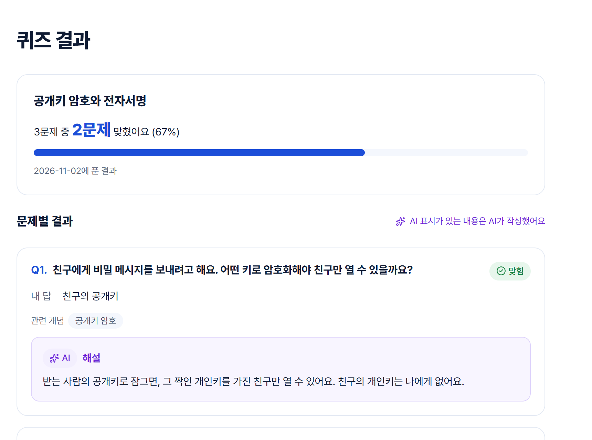

<!-- 영문 README는 준비되면 아래 링크를 다시 연다
<div align="center">
  <strong>KOR</strong> | <a href="README.en.md">ENG</a>
</div>
-->

<picture>
  <source media="(prefers-color-scheme: dark)" srcset="docs/images/banner-dark.svg">
  
</picture>

<div align="center">

         

**[화면 둘러보기 (예시 데이터)](https://lms-seven-tawny.vercel.app/)** · **[주요 화면](#주요-화면)** · **[진행 현황](#진행-현황)** · **[로컬 실행](#로컬-실행)**

</div>

학습 자료와 ChatGPT, Claude에서 나눈 공부 대화를 분석해 개념별 강점과 보완할 점을 보여 주고,
다음에 공부할 순서를 계속 다시 짜 주는 개인 맞춤형 LMS입니다.

<!-- TODO: 시연 영상이 나오면 링크를 연다
[시연 영상 보기 (3분)](https://...)
-->

<table>
  <tr>
    <th width="33%">원본 대화는 내 브라우저에서만</th>
    <th width="33%">세 AI가 따로 판단하고 비교</th>
    <th width="33%">점수는 코드, 설명은 AI</th>
  </tr>
  <tr>
    <td valign="top">대화 파일은 브라우저에서 읽고 개인정보를 가린 뒤, 내가 고른 대화만 서버로 보냅니다.</td>
    <td valign="top">GPT, Claude, Gemini가 서로의 답을 보지 않고 판단하고, 의견이 갈린 개념은 그대로 보여 줍니다.</td>
    <td valign="top">숙련도는 정해진 규칙의 코드가 계산하고, AI는 그 근거를 설명합니다. AI가 쓴 글은 보라색으로 구분합니다.</td>
  </tr>
</table>

> [!TIP]
> [체험 링크](https://lms-seven-tawny.vercel.app/)에서 **로그인 없이 체험해 보기**를 누르면 가입 없이 모든 화면을 예시 데이터로 볼 수 있습니다. 체험 중 입력한 내용은 브라우저에만 저장됩니다.

> [!IMPORTANT]
> 설문에서 찾은 문제가 어떤 기능과 설계로 이어졌는지는 중간보고서 본문에 자세히 적었습니다. 이 README는 화면과 진행 현황을 빠르게 훑어보는 용도입니다.

## 이렇게 공부합니다

메뉴도 학습자료 → 학습분석 → 맞춤학습 순서로 이 흐름을 따릅니다. 퀴즈로 확인한 결과는 숙련도 계산에 다시 들어갑니다.



색은 아래 "AI는 이렇게 씁니다"와 같습니다. 회색은 내 브라우저, 파랑은 코드가 계산하는 단계, 보라는 AI가 맡는 단계입니다.

## 주요 화면

<table>
  <tr>
    <td width="50%" valign="top">
      <br>
      <b>학습 대시보드</b><br>
      개념마다 규칙으로 계산한 숙련도 단계와 모델들의 판단, 몇 개 모델이 같은 판단을 했는지 보여 줍니다.
    </td>
    <td width="50%" valign="top">
      <br>
      <b>공부한 대화 고르기</b><br>
      내 과목 키워드로 공부한 대화만 골라 과목별로 나눕니다.
    </td>
  </tr>
  <tr>
    <td width="50%" valign="top">
      <br>
      <b>가린 내용 확인</b><br>
      이메일, 전화번호를 가린 모습을 보내기 전에 직접 확인합니다.
    </td>
    <td width="50%" valign="top">
      <br>
      <b>퀴즈 결과</b><br>
      서버가 채점하고, 문제마다 관련 개념과 해설을 붙입니다.
    </td>
  </tr>
</table>

> [!NOTE]
> 화면의 과목, 대화, 판단 결과는 팀이 직접 쓴 예시 데이터입니다. 연락처도 가짜입니다.

## AI는 이렇게 씁니다

<picture>
  <source media="(prefers-color-scheme: dark)" srcset="docs/images/flow-dark.svg">
  
</picture>

회색은 내 브라우저, 파랑은 코드가 계산하는 단계, 보라는 AI가 맡는 단계입니다. 서비스 화면도 같은 색으로 구분합니다.

| LLM이 하는 일 | LLM이 하지 않는 일 |
| --- | --- |
| 대화에서 개념을 찾고 이해 수준을 분류 | 숙련도 점수 매기기 (규칙을 정한 코드가 계산) |
| 판단 근거를 사람이 읽을 수 있게 설명 | 화면 코드 만들기 (정해진 영역의 순서, 크기, 이유만 JSON으로) |
| 다음에 공부할 순서와 그 이유를 제안 | 원본 대화 파일 받기 (브라우저에서 처리한 결과만 받음) |

## 진행 현황

| 기능 | 상태 | 내용 |
| --- | --- | --- |
| AI 대화 가져오기 | 🟢&nbsp;**동작** | ChatGPT, Claude 내보내기 파일 읽기, 대화 고르기, 개인정보 가리기, 서버 재검사 |
| 퀴즈 | 🟢&nbsp;**동작** | 목록, 풀기, 서버 채점, 결과 |
| 회원, 내 과목 | 🟢&nbsp;**동작** | 가입, 로그인 유지, 분석 동의, 과목과 키워드, 회원 탈퇴 |
| 학습 자료 | 🔵&nbsp;**API&nbsp;연결** | 올리기·목록·상세·삭제, 본문 읽기(TXT·MD·PPTX·글자가 있는 PDF). 실제 PDF·PPTX 파일 올리기는 점검 전 |
| 학습 대시보드 | 🔵&nbsp;**API&nbsp;연결** | 모델별 판단과 근거, 개념별 숙련도 단계와 변화, 추천 순서, "이 판단, 내 생각과 맞나요?" 피드백, 사전·사후평가 비교 |
| 맞춤 커리큘럼, 사전·사후평가, 검색 | 🔵&nbsp;**API&nbsp;연결** | 사전 테스트 → 핵심 개념 학습 → 개념별 확인 퀴즈 → 사후 평가 4단계와 학습 진도, 통합 검색 |
| 숙련도 | 🟠&nbsp;**로직&nbsp;구현** | 퀴즈 결과와 대화 판단을 규칙으로 계산(숫자는 초기값), 단계·근거·변화 추이 표시 |
| AI 분석, 퀴즈 만들기, AI 채점 (LLM 호출) | 🟠&nbsp;**로직&nbsp;구현** | 세 모델 판단과 비교, 학습 모드별 퀴즈 만들기, 주관식·서술형 다수결 채점 코드 완성. API 키를 넣고 실제 호출 예정 |
| 자료 요약, 챗봇 | ⚪&nbsp;**예정** | |

<details>
<summary>상태 뜻과 기능별 자세한 내용</summary>

🟢 **동작**은 실제 API로 동작, 🔵 **API 연결**은 화면이 실제 API를 부르지만 일부 흐름을 아직 실제 서버나 실제 AI 모델로 확인하지 못했다는 뜻, 🟠 **로직 구현**은 핵심 로직과 테스트까지 완료, ⚪ **예정**은 아직 만들지 않았다는 뜻입니다. 배포 주소는 백엔드가 아직 없어 모든 화면을 예시 데이터로 보여 줍니다.

- **AI 대화 가져오기:** 3GB가 넘거나 끝이 잘린 zip도 압축을 풀지 않고 브라우저에서 읽습니다. 공부한 대화 고르기와 본문 검색, 개인정보 가리기(이메일·전화번호·주민등록번호·카드번호·키·IP·이름·직접 넣은 단어), 가린 곳 확인, 대화 미리 보기, 긴 대화 나눠 보내기를 거쳐 서버에 저장하고, 서버가 개인정보 형식이 남았는지 다시 검사합니다. Claude 내보내기 받는 법을 안내하는 도움말 페이지가 있습니다.
- **회원, 내 과목:** 가입, 로그인, 로그인 유지, 로그아웃, 내 정보, AI 대화 분석 동의 변경, 과목과 키워드 관리. 커뮤니티 메뉴는 2단계로 미뤘고, 공지 화면과 API는 코드에 남아 있지만 메뉴에는 두지 않았습니다.
- **학습 대시보드:** 학습 분석 API로 개념별 판단, 모델별 판단과 근거, 모델 연결 상태, 추천 순서를 보여 줍니다. 배치 JSON 검증은 목업 배치로만 확인했습니다.
- **숙련도:** 퀴즈(채점이 끝난 문제)와 대화 판단을 정해진 규칙으로 계산해 근거 부족·보완 필요·보통·강점 네 단계로 보여 주고, 숫자 점수는 보여 주지 않습니다. 반영한 근거와 단계가 바뀐 기록을 함께 보여 줍니다. 규칙의 숫자는 근거 없는 초기값이라 사용자 테스트 뒤 조정합니다.
- **학습 자료:** 올리기(과목 선택, 이용 권한 확인, 파일 형식·크기·내용 검사), 목록, 상세, 삭제와 핵심 개념 뽑기를 API까지 연결했습니다. 자료 본문을 외부 AI로 보내는 기능은 처리방침을 정하기 전까지 꺼 둡니다.
- **AI 요약 영상:** 화면에 자리만 두고 준비 중입니다.

</details>

[](https://github.com/SpicyShrimpChip/lms/actions/workflows/frontend-ci.yml) [](https://github.com/SpicyShrimpChip/lms/actions/workflows/backend-ci.yml)

프론트와 백엔드 테스트가 해당 코드가 바뀐 PR마다 GitHub Actions에서 실행됩니다. 백엔드는 H2와 실제 PostgreSQL 16(pgvector) 두 환경에서 같은 테스트를 돌립니다.

## 왜 만드나요

생성형 AI로 공부하는 대학생을 위한 서비스입니다.

- AI로 공부한 기록은 여러 서비스에 흩어지고, 과목이 끝나면 지워지기 쉽습니다.
- 새 대화를 열 때마다 "나는 이 과목을 이만큼 안다"는 배경 설명을 다시 해야 합니다.
- 공부는 많이 했는데 **무엇을 알고 어디가 부족한지**는 스스로 알기 어렵습니다.

팀이 학생 49명에게 받은 설문에서도 생성형 AI로 공부한다는 응답이 많았고, 문항에 답한 48명 중 40명이 새 대화마다 배경을 다시 설명한다고 답했습니다. 다만 응답자의 절반 이상(31명)이 공학·IT 전공이라 일반화하기는 어렵습니다.

시작 경로는 가진 데이터에 따라 두 가지입니다.

- **AI 대화 기록이 많다면** ChatGPT, Claude 공식 내보내기 파일을 가져와 바로 분석합니다.
- **AI 대화 기록이 적다면** 학습 자료를 올려 요약과 퀴즈로 시작하고, 사이트 안의 챗봇과 퀴즈 기록이 쌓이면 같은 방식으로 분석합니다.

## 설계 원칙

- **원본 대화 파일은 서버로 보내지 않습니다.**
- **점수는 코드로 계산하고, 화면에는 판단 근거를 함께 보여 줍니다.**
- **LLM은 화면 코드를 만들지 않습니다.**
- **학습 자료는 올린 본인만 봅니다.**
- **비밀값과 로그인 정보를 안전하게 다룹니다.**

<details>
<summary>원칙별 자세한 내용</summary>

- **원본 대화 파일:** 브라우저에서 파싱 → 학습 키워드 필터 → 개인정보 마스킹을 거친 뒤, 사용자가 미리 보기로 확인하고 고른 대화만 보냅니다. 직접 넣은 가릴 단어 목록도 서버로 보내지 않고 브라우저에만 저장합니다. 서버는 받은 대화에 개인정보 형식이 남아 있으면 저장하지 않습니다.
- **점수와 근거:** 숙련도는 대화만으로 단정하지 않고 대화 분류 결과와 퀴즈 결과를 명시적인 규칙으로 계산합니다. 규칙의 숫자(가중치·기준)는 초기값이라 설정값으로 두고, 근거가 적으면 단계를 내지 않고 '근거 부족'으로 보여 줍니다. 여러 모델의 판단이 갈리면 하나로 정하지 않고 갈렸다고 보여 줍니다.
- **화면 배치:** LLM에게서는 미리 정한 영역의 순서, 크기, 이유만 JSON으로 받고, 스키마 검증을 통과한 경우에만 씁니다. 실패하면 기본 배치를 씁니다.
- **학습 자료:** 자료와 그로부터 만든 요약·퀴즈는 다른 사용자와 공유하지 않습니다. 외부 AI(OpenAI, Anthropic, Google)는 보낸 데이터를 학습에 쓰지 않는 조건의 API로 쓰고, Gemini는 결제가 연결된 프로젝트의 키만 씁니다. 제공사·국가·보관 기간은 개인정보 처리방침에 적었습니다.
- **보안:** 비밀번호는 BCrypt로 저장하고, 로그인 유지 토큰은 쓸 때마다 새로 바꾸며 재사용을 감지합니다. 로그인 시도 횟수를 제한하고, 앱과 테이블 변경용 DB 계정을 분리했습니다. 로그인 쿠키는 HttpOnly·SameSite=Strict이고, 허용하는 접속 주소는 목록으로 명시했으며, 관리자 API는 관리자만 부를 수 있습니다. 모든 기능은 로그인한 본인의 데이터만 조회합니다. 비밀값은 환경변수로만 관리합니다. 코드를 읽는 보안 점검(11/4)에서 심각한 문제는 찾지 못했지만, 실제 공격을 재현한 점검은 아닙니다. 배포 전에는 운영 프로필 지정, Swagger 끄기, CSP 적용을 다시 확인합니다.

</details>

## 기술 스택

| 영역 | 기술 |
| --- | --- |
| Frontend | React 19, TypeScript 6, Vite 8, Tailwind CSS 4, React Router 7, TanStack Query 5, Zustand 5, Axios, zod, Motion, Vitest |
| Backend | Spring Boot 3.5, Java 17, Gradle, Spring Security(JWT), Spring Data JPA, Flyway, PostgreSQL 16 + pgvector, H2(테스트) |
| LLM | OpenAI(GPT), Anthropic(Claude), Google(Gemini) 클라이언트. 모델 이름은 환경변수, 사용자별 호출 한도는 설정값. Claude는 프롬프트 캐싱으로 고정 지시문의 입력 요금을 줄임 |
| 개발 환경 | Docker Compose(로컬 PostgreSQL + pgvector), GitHub Actions, ESLint, Prettier, Husky + lint-staged, Renovate, Claude Code |

## 팀

| 역할 | 맡은 일 |
| --- | --- |
| 프론트엔드 | 화면 설계·구현, 대화 파싱·마스킹, 동적 배치 검증, 프론트 CI |
| 백엔드 | API·DB 설계, 인증·보안, LLM 연동, 숙련도 계산, 백엔드 CI |

- **협업 방식:** 기능별 브랜치 → PR → CI 통과 후 `main`에 합칩니다. API처럼 상대 작업에 영향을 주는 변경은 [`docs/frontend-requests.md`](docs/frontend-requests.md)에 정리해 함께 봅니다.
- **개발에도 AI를 씁니다:** Claude Code로 설계, 구현, 테스트를 진행하고, 사람이 PR 단위로 확인한 뒤 합칩니다.
- **개발 교훈 위키:** 에러를 해결하거나 시행착오를 겪으면 [`docs/wiki/`](docs/wiki/README.md)에 한 건씩 남기고, 비슷한 작업을 시작하기 전에 먼저 읽습니다.

- **멘토링 피드백과 반영:** 10/28·11/5 두 차례 멘토링을 받았습니다. 11/5에는 기능을 더 늘리기보다 남은 시간을 설명에 쓰라는 조언을 받아 커뮤니티 메뉴를 2단계로 미루고, 메뉴를 모으기 → 진단 → 공부 → 확인 순서로 바꾸고, 토큰 비용을 줄이려 Claude 프롬프트 캐싱을 넣고, 개인정보 처리방침을 다시 썼습니다. 설계 이유와 근거는 중간보고서에 정리합니다.

## 다음 계획

- **중간 심사까지:** 실제 LLM으로 개념 분석과 퀴즈 만들기를 한 번 돌려 대시보드와 피드백까지 확인, 실제 PDF·PPTX 자료 올리기 점검
- **2단계:** 자료 요약과 자료 기반 챗봇(대화 기록이 적은 사용자의 시작 경로), 커뮤니티 기능, 사용자 테스트로 숙련도 규칙의 숫자 조정, 배포
- **이후 후보:** Gemini 대화 가져오기, 오픈소스 모델을 직접 띄운 개인정보 가리기, 판단 근거 출처

## 폴더 구조

```text
.
├── frontend/   React 앱
├── backend/    Spring Boot API
├── docs/       세팅 매뉴얼, 기획 문서, 백엔드 설계, 프론트–백엔드 API 요청
└── .github/    CI 워크플로, Renovate 설정
```

## 로컬 실행

### 화면만 보기 (백엔드 없이)

> Node.js 24가 필요합니다.

```bash
git clone https://github.com/SpicyShrimpChip/lms.git
cd lms/frontend
npm ci
npm run dev   # http://localhost:5173
```

기본 설정은 목업 데이터(`VITE_USE_MOCK=true`)라서 백엔드 없이 모든 화면을 볼 수 있습니다.

<details>
<summary>백엔드까지 실행하기</summary>

> JDK 17과 PostgreSQL 16(pgvector 포함, `backend/db/docker-compose.yml`로 띄울 수 있음)이 필요합니다. 새 컴퓨터 세팅 순서와 막힐 때 대처는 [`docs/setup.md`](docs/setup.md), 설계는 [`docs/backend-design.md`](docs/backend-design.md)를 참고하세요.

```bash
cd lms/backend
./db/setup-local-postgres.sh # 처음 한 번: DB·계정을 만들고 backend/.env 생성 (관리자 비밀번호 필요, psql이 없으면 도커 컨테이너 안의 psql을 써서 묻지 않음)
./gradlew bootRun           # http://localhost:8080 (로컬 PostgreSQL, 테이블은 Flyway가 자동 생성)
./gradlew test              # H2 메모리 DB로 테스트
./gradlew pgTest            # 같은 테스트를 PostgreSQL(ai_lms_test)로 실행
```

- API 문서(Swagger): http://localhost:8080/swagger-ui/index.html
- 비밀값(DB 비밀번호, JWT 시크릿)은 `backend/.env`(커밋 안 됨)에만 둡니다. 형식은 `backend/.env.example` 참고.
- PostgreSQL 없이 띄우려면 `SPRING_PROFILES_ACTIVE=default ./gradlew bootRun` (H2 메모리 DB, 재시작하면 데이터가 사라짐).
- 프론트에서 실제 API로 확인하려면 `frontend/.env.development.local`(커밋 안 됨)에 `VITE_USE_MOCK=false`를 넣습니다.
- `npm ci`를 실행하면 Git 훅도 함께 설치됩니다. 커밋할 때 lint-staged, push할 때 타입 체크가 실행됩니다.

</details>

## 개발 규칙

- 브랜치: `feat/<범위>`, `fix/<범위>`, `chore/<범위>`, `docs/<범위>`
- 커밋: `feat: 학습 대시보드 숙련도 표 추가`처럼 타입 + 한국어 설명
- `main`에는 PR로만 합치고, CI 통과를 확인한 뒤 머지합니다. 리뷰 승인은 필수가 아니며, API처럼 상대 작업에 영향을 주는 변경은 상대방에게 알립니다.
- 프로젝트 규칙과 미결 사항은 [`CLAUDE.md`](CLAUDE.md)에 정리되어 있습니다.
