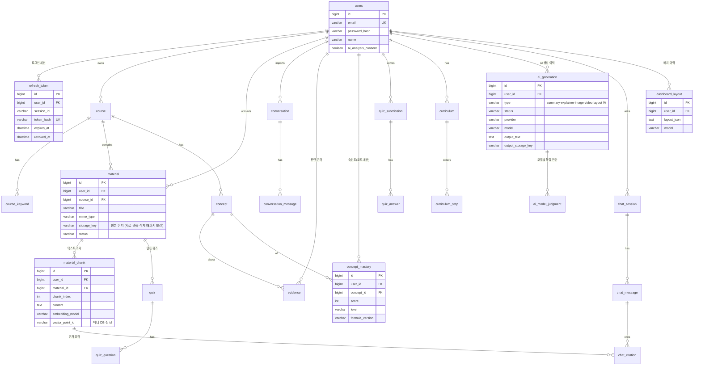

# 백엔드 설계 — DB·인증·확장 구조

최종 수정: 2026-11-02 (퀴즈 풀기·채점 구현, 문서 점검)

이 문서는 백엔드가 지금 만든 것과, 앞으로 만들 기능이 붙을 자리를 정리한다.
**지금 만든 것**과 **설계만 한 것(아직 테이블·코드 없음)**을 구분해서 읽는다. 설계 부분은 기능을 만들 때 바뀔 수 있다.

## 1. 데이터 저장소 역할

| 저장소 | 상태 | 담는 것 |
| --- | --- | --- |
| **PostgreSQL** (`ai_lms`) | 사용 중 | 회원·인증 세션, 과목, 학습 기록, 숙련도·근거, 커리큘럼, 업로드 파일 메타데이터, 자료 조각(Chunk) 원문, AI 생성 결과 메타데이터, 대시보드 배치. **소유권(누구 데이터인지)의 기준** |
| **벡터 검색** (pgvector) | 확장만 설치(`db/vector`). 임베딩 테이블은 챗봇 검색 구현 때 추가 | 자료 조각 임베딩, 유사도 검색용 인덱스. 같은 PostgreSQL 안에 두므로 `user_id` 조건을 SQL로 함께 건다 |
| **파일 저장소** (`global/storage`) | `FileStorage` 인터페이스 + `LocalFileStorage`(로컬 폴더, `app.storage.local.root`) 구현. S3는 미결 | 업로드 원본(자료·과목을 지울 때까지 보관), 나중에 AI가 만든 이미지·영상 파일 |

- 벡터 DB는 **검색 인덱스일 뿐 원본이 아니다.** 임베딩은 자료 조각 원문에서 언제든 다시 만들 수 있어야 한다.
- 로컬 테스트는 H2(PostgreSQL 모드)도 지원한다. 두 DB에서 모두 돌도록 DB 전용 문법(JSON 타입, 전용 함수)은 쓰지 않는다. H2에 없는 pgvector 확장은 `db/vector/` 마이그레이션으로 분리해 local·prod에서만 적용한다.

## 2. 지금 만든 테이블 (Flyway `backend/src/main/resources/db/migration`)

| 마이그레이션 | 테이블 | 내용 |
| --- | --- | --- |
| `V1__init_schema.sql` | `users`, `refresh_token`, `notice` | 회원, 로그인 세션, 공지사항(본문 `content`는 글자만 저장, 수정 시각 `updated_at`, 작성한 관리자 `author_id`는 탈퇴하면 NULL). MySQL 시절의 V1~V3을 PostgreSQL 문법으로 합쳐 다시 시작했다 |
| `V2__create_course.sql` | `course`, `course_keyword` | 내 과목과 키워드(입력 순서 `sort_order`) |
| `V3__create_material.sql` | `material`, `file_deletion_task` | 올린 자료의 정보(파일 내용은 저장소), 지우지 못한 저장소 파일의 재시도 목록 |
| `V4__create_conversation.sql` | `conversation_import`, `conversation_import_request`, `conversation`, `conversation_part`, `conversation_message` | 가져온 AI 대화. 가져오기 작업과 받은 요청 번호(재전송 중복 방지), 대화·조각·메시지. 프론트가 가린 글만 저장한다 |
| `V5__create_learning_analysis.sql` | `analysis_run`, `analysis_run_conversation`, `analysis_model_result`, `analysis_concept_judgment`, `analysis_judgment_evidence`, `analysis_concept_consensus`, `concept_feedback` | 학습 대화 개념 분석(모델별 결과 원본·검증한 판단·근거 메시지·개념별 비교)과 학습 모드 피드백. 아래 "학습 대화 개념 분석" |
| `V6__create_quiz.sql` | `quiz`, `quiz_question`, `quiz_choice`, `quiz_question_concept`, `quiz_submission`, `quiz_answer` | 객관식 퀴즈와 제출 기록(문제별 채점 결과). 아래 "퀴즈·시험 모드" |
| `db/vector/V0_1__enable_pgvector.sql` | (확장) | pgvector `vector` 확장. H2에는 없어 local·prod·`pgTest`에서만 읽는다. 버전을 `0.1`로 둬서 항상 `V1`보다 먼저 돈다 |
| `db/seed/R__sample_notices.sql` | (데이터) | 로컬 샘플 공지 3건. **운영(prod) 프로필은 이 폴더를 읽지 않는다** |

- 테이블 구조는 Flyway 마이그레이션 파일로만 바꾼다. 이미 적용된 `V*` 파일은 고치지 않고 새 번호를 추가한다(지금 다음은 `V7`).
- Hibernate는 `ddl-auto: validate`로 엔티티와 테이블이 맞는지 검사만 한다.

### `notice`

- 본문은 **글자로만** 저장하고 보여 준다(HTML·마크다운으로 해석하지 않음). 제목 100자, 본문 5000자.
- 본문 컬럼은 비어 있을 수 있다(API는 빈 문자열로 내려준다).
- `author_id`는 공개 응답에 내보내지 않는다. 쓰기·수정·삭제는 `/api/admin/notices`(관리자 전용)만 한다.

### `users`

| 컬럼 | 타입 | 설명 |
| --- | --- | --- |
| `id` | BIGINT PK | |
| `email` | VARCHAR(254) **UNIQUE** | 소문자로 저장. 중복은 앱 검사 + DB 제약으로 막는다 |
| `password_hash` | VARCHAR(100) | BCrypt 해시 (원본 저장 안 함) |
| `name` | VARCHAR(30) | |
| `role` | VARCHAR(20) | `USER` 또는 `ADMIN`. 가입하면 항상 `USER`, 관리자는 이 값을 DB에서 직접 `ADMIN`으로 바꿔 지정한다(역할 변경 API 없음) |
| `ai_analysis_consent` | BOOLEAN | AI 대화 분석 동의(선택) |
| `ai_analysis_consented_at` | TIMESTAMP(6) NULL | 동의 시각 |
| `terms_agreed_at`, `privacy_agreed_at` | TIMESTAMP(6) | 필수 동의 시각 |
| `created_at`, `updated_at` | TIMESTAMP(6) | |

### `refresh_token`

| 컬럼 | 타입 | 설명 |
| --- | --- | --- |
| `id` | BIGINT PK | |
| `user_id` | BIGINT FK → `users.id` **ON DELETE CASCADE** | 탈퇴하면 세션도 삭제 |
| `session_id` | VARCHAR(36) | 로그인 한 번 = 세션 하나. 회전된 토큰은 같은 값 |
| `token_hash` | VARCHAR(64) **UNIQUE** | 토큰 원문의 SHA-256 (원문 저장 안 함) |
| `expires_at` | TIMESTAMP(6) | |
| `revoked_at` | TIMESTAMP(6) NULL | 회전·로그아웃·재사용 감지로 폐기된 시각 |

### `course`, `course_keyword`

| 컬럼 | 타입 | 설명 |
| --- | --- | --- |
| `course.user_id` | BIGINT FK → `users.id` **ON DELETE CASCADE** | 소유자 |
| `course.name` / `name_key` | VARCHAR(40) / VARCHAR(80) | 이름과 중복 검사용 소문자 이름 |
| `course.semester` | VARCHAR(20) | `2026-1`·`2026-summer`·`2026-2`·`2026-winter` |
| UNIQUE `(user_id, semester, name_key)` | | 같은 사용자·학기에 대소문자만 다른 이름도 막는다 (앱 검사 + DB 제약) |
| `course_keyword` | `(course_id, sort_order)` PK, `keyword` VARCHAR(20) | `course_id` → `course.id` ON DELETE CASCADE |

### `material`

| 컬럼 | 타입 | 설명 |
| --- | --- | --- |
| `user_id` | BIGINT FK → `users.id` **ON DELETE CASCADE** | 소유자. 조회는 항상 `user_id` 조건을 함께 건다 |
| `course_id` | BIGINT NULL FK → `course.id` **ON DELETE CASCADE** | 과목 없이 올린 자료는 NULL. 과목을 지우면 자료도 지운다 |
| `title` | VARCHAR(60) | |
| `original_file_name` | VARCHAR(255) | 화면 표시용 파일 이름(경로 부분을 떼고 NFC로 정리). 저장 위치에 쓰지 않는다 |
| `file_format` / `content_type` | VARCHAR(10) / VARCHAR(100) | 서버가 내용을 확인한 형식(PDF·PPTX·TXT·MD)과 그 MIME. 브라우저가 보낸 값은 저장하지 않는다 |
| `file_size` | BIGINT | 바이트 |
| `storage_key` | VARCHAR(200) NULL **UNIQUE** | 저장소 위치 `materials/{user_id}/{UUID}.{확장자}`. 원본만 지우는 보관 정책을 위해 NULL 허용 |
| `status` | VARCHAR(20) | `UPLOADED`(저장 완료·AI 분석 전) / `PROCESSING` / `READY` / `FAILED`. API는 소문자 |

### `file_deletion_task`

지워야 할 저장소 파일(`storage_key`), 시도 횟수, 마지막 시도 시각. 자료 행을 지우는 트랜잭션에서 함께 만들고, 커밋 뒤 파일을 지우면 행도 지운다. 실패하면 남아서 `app.storage.cleanup-retry-interval`(10분)마다 다시 지운다.

## 3. ERD

처음 설계한 전체 그림이다. 지금 있는 테이블은 2번 표(`users`·`refresh_token`·`notice`·`course`·`course_keyword`·`material`·`file_deletion_task`, 대화 `conversation*`, 학습 분석 `analysis_*`·`concept_feedback`, 퀴즈 `quiz*`)이고, 그림의 나머지(`material_chunk`, `concept`, `evidence`, `concept_mastery`, `curriculum*`, `ai_generation`, `ai_model_judgment`, `chat_*`, `dashboard_layout`)는 설계안이다. 여러 모델 판단은 `ai_model_judgment` 대신 `analysis_*` 표로 만들었다(6번 "학습 대화 개념 분석").



### 장기 데이터 → 테이블 대응 (설계안)

| 필요한 데이터 | 테이블 | 메모 |
| --- | --- | --- |
| 사용자 정보 | `users` | 구현됨 |
| 과목·수강 | `course`, `course_keyword` | 구현됨 |
| 학습 기록 | `conversation`·`conversation_message`(구현됨), `quiz_submission`·`quiz_answer`(구현됨), `chat_message` | 모두 `user_id` 보유 |
| 업로드 자료 | `material`(구현됨), `material_chunk` | 형식 PDF·PPTX·TXT·MD, 20MB. 조각·임베딩은 AI 단계 |
| 개념별 숙련도 | `concept`, `concept_mastery` | 점수는 코드로 계산, `formula_version`으로 산식 변경 추적 (산식 미결) |
| AI 분석 결과·근거 | `evidence`, `ai_generation`(type=explanation) | 근거는 코드, 설명 문장은 AI. 필드를 섞지 않는다 |
| 맞춤 커리큘럼 | `curriculum`, `curriculum_step` | 순서·이유는 AI, 근거 숫자는 코드 |
| AI 생성 학습자료·이미지·영상 | `ai_generation` | 파일은 `global/storage`, 테이블에는 메타데이터와 저장 키만 |
| 다중 모델 독립 판단·통합 | `analysis_model_result`·`analysis_concept_judgment`·`analysis_concept_consensus`(구현됨) | GPT·Gemini·Claude 각각의 판단과 개념별 비교를 저장한다. **핵심 차별점이라 구조를 남겨 둔다** |
| 자료 기반 질의응답 | `chat_session`, `chat_message`, `chat_citation` | 답변 근거 조각을 기록 |
| 대시보드 배치 | `dashboard_layout` | `frontend-requests.md` 4번의 저장 제안 그대로 |

## 4. 접근 권한 구조

- **모든 사용자별 데이터 테이블은 `user_id`를 가진다.** 자식 테이블(예: `quiz_answer`)도 조회 경로에서 부모를 거쳐 `user_id`를 확인한다.
- 컨트롤러는 사용자 id를 요청 본문·경로에서 받지 않고 **토큰의 `AuthUser.userId()`만 쓴다** (`@AuthenticationPrincipal AuthUser`).
- 리포지토리 조회는 `findByIdAndUserId(id, userId)`처럼 항상 소유자 조건을 함께 건다. 없으면 403이 아니라 404로 응답해 남의 데이터 존재 여부를 알리지 않는다.
- Spring Security: 공지 조회, `/api/auth/**`(가입·로그인·갱신·로그아웃), Swagger만 공개. 나머지는 로그인 필요. 로그인하지 않으면 없는 주소도 401이다.
- **관리자:** `/api/admin/**`는 `ADMIN`만 열린다(`SecurityConfig`). 역할은 토큰에 넣지 않고 **요청마다 DB에서 읽는다**(`SessionValidator.findActiveRole`, 세션 확인과 같은 쿼리 한 번). 그래서 역할을 바꾸면 같은 토큰도 바로 달라진다. 규모가 커져 이 조회가 부담이 되면 캐시를 붙이거나 토큰에 역할을 넣는 방식을 검토한다(그땐 역할 변경이 토큰이 끝날 때까지 늦게 반영됨).
- 앱 DB 계정(`ai_lms_app`)은 데이터 읽기·쓰기만 할 수 있고 테이블을 바꿀 수 없다. 테이블 변경은 마이그레이션 계정(`ai_lms_migrator`)만 한다.

## 5. 인증 흐름

| 항목 | 방식 |
| --- | --- |
| 비밀번호 | BCrypt. 규칙은 프론트와 같은 4조건(8자 이상·영문·숫자·특수문자) + BCrypt 한도 72바이트 |
| Access Token | JWT(HS256), 15분, `sub`=사용자 id, `sid`=세션 id. 응답 본문으로 주고 프론트는 **메모리에만** 둔다 |
| Refresh Token | 256비트 난수, 14일, HttpOnly 쿠키(`Path=/api/auth`, `SameSite=Strict`, 운영 `Secure`). DB에는 SHA-256만 |
| 토큰 회전 | 갱신할 때마다 새 Refresh Token 발급, 이전 것 폐기 |
| 재사용 감지 | 폐기된 Refresh Token이 다시 오면 그 세션의 토큰을 모두 폐기 → 같은 세션의 Access Token도 즉시 401 |
| 로그아웃 | 세션 폐기 + 쿠키 삭제. Access Token은 요청마다 세션이 살아 있는지 확인하므로 만료 전이라도 바로 막힌다 |
| CSRF | 인증은 Authorization 헤더라 일반 API는 CSRF 대상이 아니다. 쿠키를 쓰는 `/api/auth/login·refresh·logout`은 `SameSite=Strict` + `X-Requested-With: XMLHttpRequest` 헤더 필수 |
| CORS | 허용 출처는 설정값(`app.cors.allowed-origins`). 개발·배포 모두 같은 출처(프록시·rewrite)라 평소엔 쓰이지 않는다 |
| 반복 로그인 실패 | 같은 이메일+IP 15분에 5회 → 15분 잠금(429), 같은 IP 50회 → 잠금. 메모리 저장(서버 1대 기준) |
| 계정 존재 노출 | 로그인 실패 문구를 하나로 통일, 없는 계정도 BCrypt 비교를 수행해 응답 시간을 맞춘다 (회원가입의 이메일 중복 409는 요구사항상 알린다) |

알려진 한계 (다음 단계에서 다룸)

- 여러 탭이 거의 동시에 갱신하면 한쪽이 재사용으로 판정되어 로그아웃될 수 있다. 프론트는 한 탭 안에서 갱신을 한 번만 보내도록 묶어 두었다.
- 폐기·만료된 `refresh_token` 행을 지우는 정리 작업이 아직 없다.
- 로그인 실패 기록은 메모리에 있어 서버를 여러 대 띄우면 공유되지 않는다(배포 구성 미결).

## 6. 벡터 DB 확장 방식 (설계안, 코드 없음)

### 패키지 자리

```
global/
├── llm/          LlmClient (제공사별 구현 + mock). 여러 모델 독립 판단 → 통합
├── embedding/    EmbeddingClient (임베딩 모델 미결)
├── vector/       VectorStore 인터페이스 — upsert, search(filter), deleteByMaterial, deleteByUser
│                 구현: PgVectorStore(pgvector, 확정) — 구현체는 인터페이스 뒤에 둔다
└── storage/      FileStorage (로컬 / S3)
domain/
├── material/     업로드 → 텍스트 추출 → 조각 나누기(material_chunk) → 임베딩 → VectorStore.upsert
└── chatbot/      질문 → VectorStore.search → DB에서 소유권 재확인 → LLM 답변 + chat_citation
```

### ID 연결과 소유권 확인

1. 자료 조각은 **`material_chunk`에 먼저 저장**하고, 벡터 DB 점(point) id는 `material_chunk.id`(또는 저장한 `vector_point_id`)로 맞춘다.
2. 점의 payload에는 검색 필터용으로 `user_id`, `material_id`, `course_id`, `embedding_model`만 넣는다 (본문·개인정보는 넣지 않는다).
3. 검색은 `user_id = 로그인 사용자`로 필터한 뒤, 돌아온 조각 id로 **`WHERE id IN (...) AND user_id = :me`로 다시 조회**한다. 없거나 소유자가 다르면 버린다. **벡터 DB의 `user_id`는 검색 범위를 줄이는 용도일 뿐 권한 판단에 쓰지 않는다.**

### 삭제 연쇄

| 사건 | DB 행 | 벡터 | 파일 |
| --- | --- | --- | --- |
| 자료 삭제 (구현됨) | `material` 삭제 → 그 자료로 만든 `quiz`(문제·제출 기록 포함, 구현됨)와 나중에 붙을 `material_chunk`·근거는 FK ON DELETE CASCADE로 연쇄 삭제 → 숙련도 재계산(숙련도 단계) | `deleteByMaterial(materialId)` (벡터 단계) | 원본 파일: `file_deletion_task`로 커밋 뒤 삭제 |
| 과목 삭제 (구현됨) | 그 과목의 `material`을 앱이 먼저 지우고(파일 삭제 작업을 남기려고) `course` 삭제. 과목 없는 자료·다른 과목 자료는 남는다. FK CASCADE는 마지막 안전장치 | 자료마다 위와 같음 | 그 과목 자료의 원본 파일 |
| 과목 삭제 → 가져온 대화 (구현됨) | 그 과목의 `conversation`을 FK `ON DELETE CASCADE`로 삭제(조각·메시지도 연쇄). 파일이 없어 앱이 따로 지우지 않는다 | 해당 없음 | - |
| 대화 삭제 (구현됨, `DELETE /api/conversations/{id}`) | `conversation` 삭제 → 조각·메시지 연쇄. 나중에 붙을 근거도 FK CASCADE로 | 해당 없음 | - |
| 대화 한 건 삭제 → 분석 (구현됨) | 그 대화를 쓴 `analysis_run` 전체를 앱이 먼저 삭제(`AnalysisCleanup`, 모델이 쓴 이유에 대화 내용이 담길 수 있어서). 모델 결과·판단·근거·비교는 연쇄 삭제, 피드백의 `analysis_run_id`는 NULL | 해당 없음 | - |
| AI 대화 분석 동의 철회 (구현됨, `PATCH /api/users/me/consents`) | 그 사용자의 `conversation`(조각·메시지 연쇄)과 `conversation_import`(받은 요청 연쇄)를 동의 변경과 같은 트랜잭션에서 삭제. 과목·자료는 남는다. 그 사용자의 `analysis_run`도 모두 삭제(모델 결과·판단·근거·비교 연쇄). 학습 피드백(`concept_feedback`)은 사용자가 쓴 기록이라 남긴다(미결: 철회 때 함께 지울지). 사용자 행을 잠가 같은 사용자의 대화 가져오기·분석과 차례로 처리한다. 숙련도 재계산은 숙련도를 만들 때 추가 | 해당 없음(대화는 임베딩하지 않는 안) | - |
| 탈퇴 (미구현) | `users` 삭제 → 모든 자식 행 `ON DELETE CASCADE` | `deleteByUser(userId)` | **CASCADE는 저장소 파일을 지우지 못한다.** 탈퇴 처리 코드가 같은 트랜잭션에서 그 사용자 자료의 `storage_key`를 `deleteAfterCommit`으로 넘기거나 `materials/{user_id}/` 폴더 삭제 작업을 남겨야 한다 |

- 벡터 DB·파일 삭제는 DB 트랜잭션 밖이라 실패할 수 있다. 파일은 **구현됨**: `FileCleanupService.deleteAfterCommit`이 같은 트랜잭션에 `file_deletion_task`를 남기고 커밋 뒤 지운다. 롤백되면 작업 행도 사라져 파일이 그대로 남고(DB가 가리키는 파일이 먼저 사라지지 않음), 삭제에 실패하면 작업 행이 남아 다시 시도한다. 벡터 삭제도 같은 작업 목록에 붙이면 된다.
- 올리기는 반대 순서다: 검사 → 파일 저장 → DB 행 저장. DB 저장이나 커밋이 실패하면 방금 저장한 파일을 지우고(트랜잭션 동기화 `afterCompletion`), 그것도 실패하면 `file_deletion_task`로 넘긴다.

### 가져온 AI 대화 (11/1 구현)

| 테이블 | 내용 |
| --- | --- |
| `conversation_import` | 가져오기 작업. 프론트가 "보내기"마다 만든 UUID(`client_import_id`)와 전체 요청 수. 요청을 모두 받으면 `COMPLETED` |
| `conversation_import_request` | 받은 요청 번호. 같은 번호를 다시 받으면 저장하지 않고 같은 결과를 돌려준다 |
| `conversation` | 대화 하나. `UNIQUE(user_id, source, client_id)`라 같은 대화는 한 번만 저장한다(다른 과목으로 다시 보내도 처음 과목 유지). `import_id`는 이 대화를 마지막으로 보낸 작업 |
| `conversation_part` | 받은 조각 번호(조각 없이 온 대화는 1번). 조각이 순서와 상관없이 여러 요청으로 와도 이어 붙인다 |
| `conversation_message` | 메시지. 순서는 `(part_index, seq)`. 20,000자가 넘는 메시지는 프론트가 나눠 보내고 `continued`로 이어짐을 표시한다 |

- **분석에 쓰는 조건:** 사용자가 지금 AI 대화 분석에 동의했고, 대화의 `import_id` 작업이 `COMPLETED`이고, 조각을 모두 받은 대화(`ConversationRepository.findAnalyzable`). 일부 요청만 성공한 작업의 대화는 지우지 않고 남기되 분석에서 뺀다.
- 끝나지 않은 작업의 대화를 새 작업에서 다시 보내면 그 대화를 새 작업으로 옮긴다(새 작업이 끝나면 분석 대상).
- 이미 다 받은 대화를 다르게 나눠 다시 보내면 중복으로 보고 건너뛴다. 다 받지 못한 대화를 다르게 나눠 보내면 422로 거절한다.
- 한도: 요청 2MB(`app.conversation-import.max-request-size`, 본문을 읽기 전에 `Content-Length`로 확인), 요청당 대화 50개, 메시지당 20,000자, 제목 500자. 대화당 메시지 수는 제한하지 않는다(분석 비용 기준 한도는 LLM 단계에서 정한다).
- TODO(미결): 끝나지 않고 버려진 작업과 그 대화를 언제 정리할지, 이미 가져온 대화가 외부 서비스에서 길어졌을 때(같은 id, 메시지 추가) 새 메시지를 받을지.

### 학습 대화 개념 분석 (11/1, 1차 구현)

흐름(`AnalysisService`):
1. **준비 (트랜잭션):** 사용자 행을 잠그고 동의·과목 소유·키워드·진행 중 분석·24시간 횟수(`app.analysis.daily-run-limit`)를 확인한다. `findAnalyzableInCourse`(동의 + 가져오기 완료 + 조각 모두 받음)로 대화를 읽고, `AnalysisInputBuilder`가 보낼 글을 만든 뒤 `analysis_run`(RUNNING)과 쓴 대화를 저장하고 커밋한다.
2. **모델 호출 (트랜잭션 밖):** 설정된 모델마다 같은 지시문(`AnalysisPrompt`, `prompt_version`)을 동시에 보낸다. 다른 모델의 판단은 넣지 않는다. 시간 초과·429·5xx는 `app.llm.max-retries`만큼 다시 부른다.
3. **저장 (트랜잭션):** 다시 사용자 행을 잠그고 동의를 확인한다. 그 사이 철회하거나 쓴 대화를 지웠으면 결과를 버리고 409. 모델마다 `analysis_model_result`(원본 `raw_output`, 토큰 수, 시도 횟수, 걸린 시간)를 남기고, 검증한 판단·근거와 개념별 비교를 저장한다.

보내는 글 줄이기: 과목 키워드가 들어간 메시지와 앞뒤 `context-window`개만, 메시지 하나는 `max-message-chars`까지, 전체는 `max-input-chars`까지(최근 대화부터). 대화는 가져올 때 이미 가린 글이다. TODO: 같은 메시지 안에 섞인 사생활 이야기는 걸러지지 않는다.

검증(`ModelOutputParser`): 개념은 과목 키워드만, 상태는 4가지만, 근거 메시지는 이번에 보낸 것이고 `user_*` 근거는 사용자 메시지·`ai_explanation`은 AI 메시지여야 한다(아니면 버리고 `dropped_evidence_count`). 이해·부분 이해·이해 부족인데 사용자가 쓴 근거가 없으면 비교에는 판단 근거 부족으로 쓰고(`status`, `adjusted_reason`) 모델이 보고한 값은 `reported_status`에 남긴다. 근거 부족을 이해 부족으로 바꾸지 않는다.

비교(`ConsensusCalculator`): 판단한 모델 수(`judged_count`)와 같은 판단 수(`agree_count`)로 `UNANIMOUS`/`MAJORITY`/`DISAGREEMENT`/`SINGLE_MODEL`/`NO_RESULT`. 실패·형식 오류·미설정 모델과 개념을 빠뜨린 모델은 판단한 수에 넣지 않는다. 정확도·숙련도가 아니다.

학습 피드백(`concept_feedback`): 과목·개념마다 하나(UNIQUE). PUT으로 남기거나 바꾸고 DELETE로 취소. AI 결과·숙련도는 바꾸지 않고, 추천 순서(`studyOrder`: 더 공부할래요 → 이해 부족 → 부분 이해 → 의견 불일치 → 근거 부족 → 이해)와 확인 퀴즈 권유만 바뀐다.

AI 모델 설정: 키·모델 이름은 환경변수(`OPENAI_API_KEY`·`OPENAI_MODEL`, `ANTHROPIC_API_KEY`·`ANTHROPIC_MODEL`, `GEMINI_API_KEY`·`GEMINI_MODEL`)로만. 하나라도 없으면 미설정(호출하지 않음).

TODO(미결):
- **외부 AI로 대화를 보내기 전에 개인정보처리방침에 제공사·국가(국외 이전)·학습 미사용 여부를 적어야 한다(`PrivacyPage.tsx` TODO).** 실제 사용자 데이터로 키를 켜기 전에 처리한다.
- 쓸 모델 이름, 모델별 비용 한도·월 예산, 분석을 비동기로 돌릴지(지금은 요청 안에서 기다림, 최대 약 2분).
- 숙련도 점수 산식(대화 비교 결과 + 퀴즈·시험 결과의 가중치).

### 퀴즈·시험 모드 (11/2 객관식 풀기·채점 구현, 나머지는 설계안)

**구현됨 (11/2, `V6`, `domain/quiz`):** 객관식 학습용 퀴즈를 풀고 서버가 채점한다(`QuizGrader`, 정답 번호와 같은지만 본다). 풀기 전 응답(`QuizResponse`)에는 정답·해설 필드가 아예 없다. 다시 풀면 `quiz_submission`이 쌓이고 화면은 가장 최근 것을 쓴다. 회원·과목·자료를 지우면 퀴즈와 제출 기록도 FK CASCADE로 지워진다. 아직 없는 것: 퀴즈 만들기(AI 생성, 모델 키가 정해지면), 단답·서술형·배점, 결과를 대시보드 근거·숙련도에 반영(산식 미결). 그때는 아래 표(안)의 열을 새 마이그레이션으로 더한다.

| 구분 | 학습용 확인 퀴즈 | 모의시험 |
| --- | --- | --- |
| 목적 | 개념 이해 확인, "이미 알아요" 검증 근거 | 실제 시험처럼 풀고 개념별 점수 |
| 문항 | 객관식·단답형 위주, 개념 1개에 1~3문항 | 단답형·주관식·서술형, 문항마다 관련 개념(여러 개 가능)과 배점 |
| 채점 | 객관식·단답형은 코드(정답 목록·정규화 비교), 부분 점수 저장 | 단답형은 코드, 주관식·서술형은 채점 기준(rubric) 항목별로 모델이 판단하고 코드가 점수를 합산. 모델 채점은 근거 문장을 함께 저장 |
| 사용자 피드백 버튼 | 있음 (학습 모드) | **없음.** 답안과 채점 기준으로만 결과를 낸다 |
| 결과 반영 | 개념별 정오·부분 점수 → 추천 순서 갱신, 피드백 검증 근거 | 개념별 획득 점수/가능 점수, 오답 유형, 부족한 개념 추천. AI 대화 비교보다 우선하는 근거로 쓴다 |
| 근거 부족 | 개념별 문항 수가 적으면(예: 가능 점수가 기준 미만) "근거 부족"으로 두고 숙련도를 단정하지 않는다 | 같음 |

표(안): `quiz`(type: PRACTICE/EXAM, course_id, material_id NULL, source_run_id NULL), `quiz_question`(type: CHOICE/SHORT/ESSAY, 배점, 정답·채점 기준), `quiz_question_concept`(문항-개념, 배점 비율), `quiz_submission`(mode, 제출 시각), `quiz_answer`(답안, 점수, 채점 방식 CODE/MODEL, 오답 유형, 모델 채점 근거), `concept_score`(제출별 개념 획득/가능 점수). 숙련도(`concept_mastery`)는 이 결과와 대화 비교 결과를 받아 코드로 계산한다(산식 미결).

API(안): `POST /api/quizzes/practice`(개념으로 확인 퀴즈 만들기), `POST /api/exams`(과목 모의시험 만들기), `POST /api/quizzes/{id}/submissions`(제출·채점), `GET /api/quizzes/{id}/submissions/latest`. 지금 프론트 퀴즈 타입은 객관식만 있어(`types/quiz.ts`) 단답·서술형을 붙일 때 같은 PR에서 타입을 바꾼다.

### 업로드 원본 보관 (11/1 결정, 일부 미결)

- 원본은 AI 분석(글 뽑기·요약·퀴즈)에 다시 쓰므로 **올린 직후 지우지 않고, 자료나 그 과목을 지울 때까지 보관한다.** 다른 사용자와 공유하지 않는다.
- 저장 위치는 `app.storage.local.root`(환경변수 `STORAGE_LOCAL_ROOT`, 기본 `backend/uploads`, `.gitignore`에 있음). 운영은 서버를 다시 배포해도 지워지지 않는 위치로 지정한다.
- **TODO(미결):** 원본의 장기 보관 기간과 자동 삭제(예: 글 뽑기·분석이 끝난 뒤 N일 지나면 원본만 지우고 `storage_key`를 NULL로), 운영 저장소(AWS S3 등). 정해지면 개인정보 처리방침(`PrivacyPage.tsx` 4번)도 같은 PR에서 고친다.

## 7. AI 분석·RAG와의 연결

- **숙련도:** `evidence`(대화 분류 신호·퀴즈 정오) → 점수 계산 클래스(가중치 설정값, 산식 미결) → `concept_mastery`. LLM은 `evidence`와 점수를 받아 설명만 쓴다(`aiExplanation`).
- **다중 모델 (1차 구현):** 같은 입력을 GPT·Claude·Gemini `LlmClient`에 따로 보내 각 결과를 `analysis_model_result`·`analysis_concept_judgment`에 저장하고, 비교 규칙(코드)이 `analysis_concept_consensus`를 만든다(설계안의 `ai_model_judgment` 대신). 위 "학습 대화 개념 분석" 참고.
- **RAG 질의응답:** 6번 흐름으로 근거 조각을 찾고, 답변과 함께 `chat_citation`에 근거를 남겨 화면에 출처를 보여 준다.
- **맞춤 설명서·이미지·영상:** 약점 개념 → 관련 조각 검색 → 생성 요청 → `ai_generation`에 상태·모델·결과 위치 저장. 파일은 `global/storage`.
- 모든 AI 호출은 로그인 사용자의 `user_id` 범위 데이터만 입력으로 쓴다.

## 8. 로컬 PostgreSQL 설정

새 컴퓨터 세팅 전체 순서와 막힐 때 대처는 [`docs/setup.md`](setup.md)에 있고, 아래는 요약이다.

```bash
cd backend/db
POSTGRES_PASSWORD='관리자비밀번호' docker compose up -d   # pgvector/pgvector:pg16 (127.0.0.1:5432에만 열림). Docker 대신 직접 설치해도 된다(pgvector 필요)
cd ..
./db/setup-local-postgres.sh   # 관리자 비밀번호 + 새 계정 비밀번호 입력 → DB·계정·vector 확장 생성 → backend/.env 생성
./gradlew bootRun              # 처음 실행할 때 Flyway가 ai_lms에 테이블을 만든다
```

- 스크립트는 `ai_lms`, `ai_lms_test` DB와 `ai_lms_migrator`(DDL, DB 소유자), `ai_lms_app`(읽기·쓰기만) 계정을 만든다. 이미 있으면 아무것도 바꾸지 않고 멈춘다.
- 일반 DataSource는 `ai_lms_app`, Flyway는 `ai_lms_migrator`를 쓴다 (`application-local.yaml`).
- `vector` 확장은 슈퍼유저만 만들 수 있어 스크립트가 미리 설치한다. Flyway의 `db/vector` 마이그레이션은 `IF NOT EXISTS`라 그대로 통과한다.
- 원격 공유 DB를 쓸 때는 5432를 공인망에 열지 말고 VPN 사설 주소 + SSL로 접속하며, 주소·비밀번호는 `backend/.env`로만 관리한다.

### 테스트 전용 DB (`ai_lms_test`)

`./gradlew pgTest`는 같은 테스트를 실제 PostgreSQL에서 돌린다. 테스트는 매번 회원·세션 행을 지우므로 **서비스 DB(`ai_lms`)와 분리한 `ai_lms_test`에서만** 돈다. `ai_lms_test`는 위 스크립트가 함께 만든다. 다른 주소를 쓰려면 `TEST_DB_URL`을 지정한다.

- Gradle이 시작 전에 DB 이름이 `_test`로 끝나는지 확인하고, 테스트 코드(`TestDatabaseGuard`)가 스프링이 뜨기 전에 한 번 더 확인한다. 둘 다 통과하지 못하면 DB에 접속하지 않고 멈춘다.

### psql에서 확인할 SQL

```sql
\c ai_lms
\dt                                                     -- users, refresh_token, notice, course*, material, file_deletion_task, conversation*, analysis_*, concept_feedback, quiz*, flyway_schema_history
SELECT version, description, success, installed_on FROM flyway_schema_history ORDER BY installed_rank;
\d users                                                -- uk_users_email UNIQUE
SELECT extname, extversion FROM pg_extension;            -- vector
SELECT id, email, name, ai_analysis_consent, created_at FROM users;   -- password_hash는 조회하지 않아도 된다
SELECT id, user_id, session_id, expires_at, revoked_at FROM refresh_token ORDER BY id;  -- token_hash는 원문이 아니다
SELECT * FROM notice ORDER BY created_at DESC;
```
